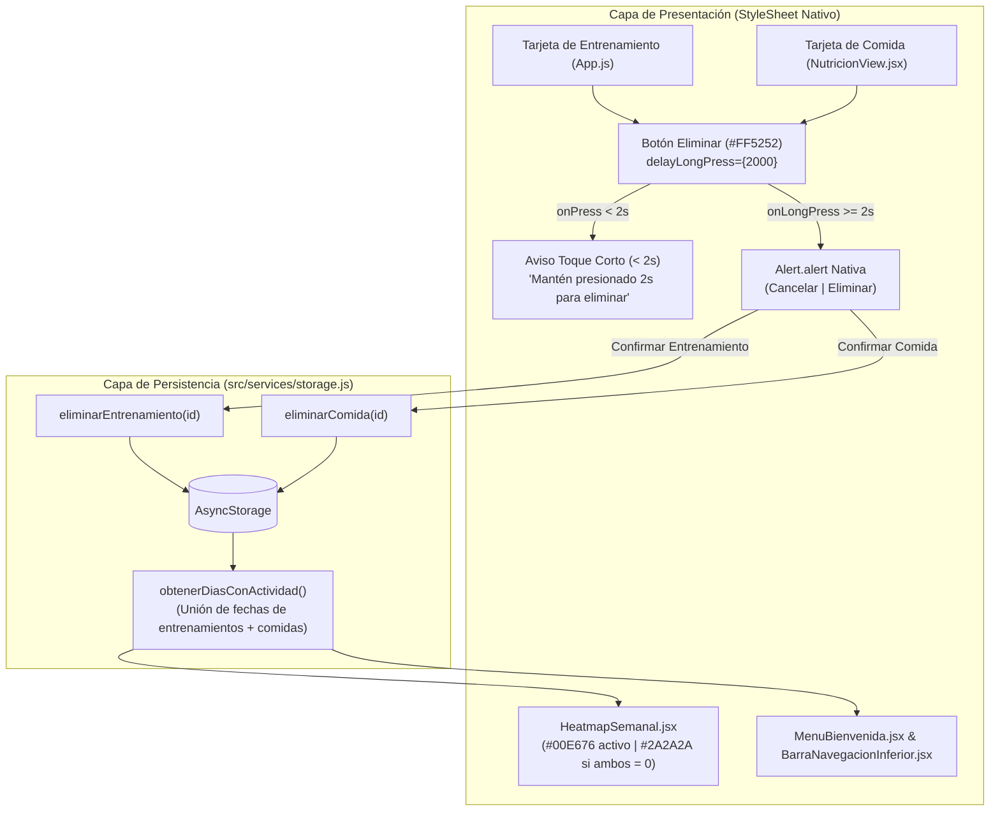

# Plan de Implementación Técnica: 001-borrar-registros

- **Especificación Asociada:** [specs/001-borrar-registros/spec.md](file:///d:/MiNuevaApp/mi-fitness-app/specs/001-borrar-registros/spec.md)
- **Estado del Plan:** aprobado
- **Fecha:** 2026-10-22

---

## 1. Arquitectura y Flujo de Datos



---

## 2. Contratos Técnicos por Archivo

### 2.1. Servicio de Persistencia ([src/services/storage.js](file:///d:/MiNuevaApp/mi-fitness-app/src/services/storage.js))

1. **Nueva función `eliminarEntrenamiento(id)` *(Cumple RF-5, RF-7, RF-12)*:**
   ```js
   /**
    * Elimina de forma inmutable un entrenamiento por su ID en AsyncStorage.
    * @param {string} id - Identificador único del entrenamiento a eliminar
    * @returns {Promise<Array<Object>>} Lista actualizada e inmutable de entrenamientos
    */
   export const eliminarEntrenamiento = async (id) => {
     const entrenamientosActuales = await cargarEntrenamientos();
     const nuevaListaInmutable = entrenamientosActuales
       .filter((item) => String(item.id) !== String(id))
       .map((item) => ({ ...item }));

     await AsyncStorage.setItem(
       STORAGE_KEY,
       JSON.stringify(nuevaListaInmutable)
     );

     return nuevaListaInmutable;
   };
   ```
   - *Nota de consistencia (RF-12):* Si `AsyncStorage.setItem` falla, lanza el error hacia la capa de vista para que la interfaz conserve el estado previo y muestre la alerta de fallo.

2. **Nueva función `eliminarComida(id)` *(Cumple RF-6, RF-7, RF-12)*:**
   ```js
   /**
    * Elimina de forma inmutable una comida por su ID en AsyncStorage.
    * @param {string} id - Identificador único de la comida a eliminar
    * @returns {Promise<Array<Object>>} Lista actualizada e inmutable de comidas
    */
   export const eliminarComida = async (id) => {
     const comidasActuales = await cargarComidas();
     const nuevaListaInmutable = comidasActuales
       .filter((item) => String(item.id) !== String(id))
       .map((item) => ({ ...item }));

     await AsyncStorage.setItem(
       STORAGE_KEY_COMIDAS,
       JSON.stringify(nuevaListaInmutable)
     );

     return nuevaListaInmutable;
   };
   ```

3. **Actualización de `obtenerDiasConActividad()` *(Cumple RF-10, RF-11)*:**
   - Obtiene en paralelo `cargarEntrenamientos()` y `cargarComidas()`.
   - Extrae las fechas locales (`YYYY-MM-DD`) de ambos arreglos de manera inmutable (`[...fechasEntrenamientos, ...fechasComidas]`).
   - Devuelve el conjunto único `Array.from(new Set(fechasCombinadas))`.
   - De este modo, cuando una fecha se queda con `0` entrenamientos **y** `0` comidas, desaparece automáticamente del arreglo de días activos y su celda en `HeatmapSemanal` pasa a gris neutro (`#2A2A2A`).

---

### 2.2. Vista de Entrenamientos y Estado Global ([App.js](file:///d:/MiNuevaApp/mi-fitness-app/App.js))

1. **Botón Visual de Eliminación con Pulsación de 2 Segundos *(Cumple RF-1, RF-2, RF-3, RF-4)*:**
   - En cada tarjeta renderizada por `renderizarItem`:
     - Se agrega un `TouchableOpacity` con estilo visual de peligro (`backgroundColor: '#2C1518'`, `borderColor: '#FF5252'`, `borderWidth: 1.5`, texto/ícono `#FF5252` `"🗑 Mantener 2s"`).
     - `delayLongPress={2000}`:
       - `onPress`: Muestra durante 2.5 segundos un aviso visual (`avisoBorrado`) indicando *"Mantén presionado el botón rojo por 2 segundos para eliminar."*
       - `onLongPress`: Dispara `Alert.alert('⚠️ Eliminar entrenamiento', '¿Seguro que deseas eliminar "' + item.ejercicio + '"? Esta acción no se puede deshacer.', [{ text: 'Cancelar', style: 'cancel' }, { text: 'Eliminar', style: 'destructive', onPress: () => confirmarEliminarEntrenamiento(item.id) }])`.
2. **Sincronización Global tras Borrar Entrenamiento o Comida *(Cumple RF-8, RF-9, RF-10, RF-11)*:**
   - Al eliminar un entrenamiento (`confirmarEliminarEntrenamiento(id)`):
     - Invoca `const nuevaLista = await eliminarEntrenamiento(id)`.
     - Invoca `const nuevosDias = await obtenerDiasConActividad()`.
     - Actualiza `setEntrenamientos(nuevaLista)` y `setDiasConActividad(nuevosDias)`.
   - Al registrar o eliminar una comida desde `NutricionView` (`manejarCambioComidas(nuevaListaComidas)`):
     - Actualiza `setComidas(nuevaListaComidas)` y recalcula `obtenerDiasConActividad()` para actualizar `setDiasConActividad(nuevosDias)` en tiempo real.

---

### 2.3. Vista de Nutrición ([src/components/NutricionView.jsx](file:///d:/MiNuevaApp/mi-fitness-app/src/components/NutricionView.jsx))

1. **Botón Visual de Eliminación en Cada Tarjeta de Comida *(Cumple RF-1, RF-2, RF-3, RF-4, RF-6, RF-9, RF-12)*:**
   - En `renderizarComida`, se incluye el botón visual rojo (`#FF5252`) con `delayLongPress={2000}`.
   - `onPress` (toque corto `< 2000 ms`): Muestra el aviso visual en pantalla recordando mantener presionado durante 2 segundos.
   - `onLongPress` (`>= 2000 ms`): Abre `Alert.alert('⚠️ Eliminar comida', '¿Seguro que deseas eliminar "' + item.nombre + '" (' + item.calorias + ' kcal)?', ...)`.
   - Al confirmar **"Eliminar"**:
     - Llama a `await eliminarComida(item.id)`.
     - Actualiza `comidasInternas` y notifica a `App.js` mediante `onComidaRegistrada(listaActualizada)` para que se recalculen inmediatamente:
       - Calorías y macronutrientes diarios en `NutricionView`.
       - `Kcal hoy` en `MenuBienvenida`.
       - Insignia de contador en `BarraNavegacionInferior`.
       - Estado de la celda del día en `HeatmapSemanal`.

---

## 3. Plan de Verificación y Pruebas

1. **Pruebas Automatizadas de Unidad/Integración (Node Script):**
   - Verificar que `eliminarEntrenamiento(id)` y `eliminarComida(id)` sean inmutables y filtren exactamente el `id` indicado.
   - Verificar que `obtenerDiasConActividad()` mantenga el día activo si hay 0 entrenamientos pero 1 comida, y que devuelva `[]` (apagando la celda a `#2A2A2A`) cuando tanto entrenamientos como comidas queden en `0`.
   - Verificar que un fallo simulado en `AsyncStorage.setItem` lance error y sea capturado sin corromper el estado.
2. **Verificación de Sintaxis y AST/JSX:**
   - Validar con `@babel/parser` que `src/services/storage.js`, `src/components/NutricionView.jsx` y `App.js` compilen sin errores.
3. **Actualización de Memoria:**
   - Actualizar `MEMORY.md` al finalizar la implementación.
