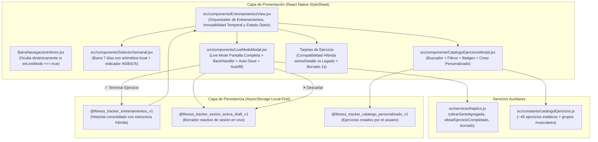

# Plan de Implementación Técnica: 003-registro-entrenamientos-activo

- **Especificación Asociada:** [specs/003-registro-entrenamientos-activo/spec.md](file:///d:/MiNuevaApp/mi-fitness-app/specs/003-registro-entrenamientos-activo/spec.md)
- **Estado del Plan:** aprobado
- **Fecha:** 2026-10-23

---

## 1. Arquitectura y Flujo de Datos



---

## 2. Contratos Técnicos por Archivo

### 2.1. Catálogo Estático y Grupos Musculares ([src/constants/catalogoEjercicios.js](file:///d:/MiNuevaApp/mi-fitness-app/src/constants/catalogoEjercicios.js))
- Define `GRUPOS_MUSCULARES` con sus nombres y colores:
  - `Pecho` (`#FF5252`)
  - `Espalda` (`#448AFF`)
  - `Pierna` (`#00E676`)
  - `Hombro` (`#FFAB00`)
  - `Brazo` (`#E040FB`)
  - `Core` (`#FF6D00`)
- Define `CATALOGO_EJERCICIOS_BASE` con ~45 ejercicios estándar detallando `{ id, nombre, grupoMuscular, implemento }`.
- Exporta utilidades `obtenerColorGrupoMuscular(grupo)` y `obtenerInsigniaImplemento(implemento)`.

### 2.2. Capa de Almacenamiento Local ([src/services/storage.js](file:///d:/MiNuevaApp/mi-fitness-app/src/services/storage.js))
- Claves agregadas:
  - `STORAGE_KEY_CATALOGO_PERSONALIZADO = '@fitness_tracker_catalogo_personalizado_v1'`
  - `STORAGE_KEY_SESION_ACTIVA_DRAFT = '@fitness_tracker_sesion_activa_draft_v1'`
- Funciones para Catálogo Personalizado:
  - `cargarCatalogoPersonalizado()`: Carga arreglo inmutable de ejercicios creados por el usuario.
  - `guardarEjercicioPersonalizado({ nombre, grupoMuscular, implemento })`: Valida que `nombre.trim().length >= 2`, previene duplicados insensibles a mayúsculas y acentos, y persiste de forma inmutable.
- Funciones para Borrador de Sesión Activa (Live Mode):
  - `cargarSesionActivaDraft()`: Recupera el borrador `{ ejercicio, grupoMuscular, implemento, seriesDetalle, iniciadoEn }` si existe.
  - `guardarSesionActivaDraft(draft)`: Guarda de forma inmutable el borrador serializado.
  - `eliminarSesionActivaDraft()`: Remueve la clave del borrador al terminar o descartar.
- Normalización Híbrida en `guardarEntrenamiento(nuevoRegistro)`:
  - Si `nuevoRegistro.seriesDetalle` está presente y es arreglo no vacío:
    - Sanitiza cada serie: `pesoNum = Math.max(0, parseFloat(serie.peso) || 0)`, `repsNum = Math.max(0, parseInt(serie.repeticiones, 10) || 0)`.
    - Calcula de forma defensiva:
      - `series`: `seriesDetalle.length`
      - `repeticiones`: suma de todas las reps
      - `peso`: peso máximo alcanzado
      - `pesoMaximo`: peso máximo alcanzado
      - `volumenTotal`: suma de `peso * reps` de todas las series
      - `seriesDetalle`: arreglo clonado de series sanitizadas.
  - Si no viene `seriesDetalle`, mantiene la estructura legacy `{ series, repeticiones, peso }` garantizando 100% retrocompatibilidad.

### 2.3. Retroalimentación Háptica ([src/services/haptics.js](file:///d:/MiNuevaApp/mi-fitness-app/src/services/haptics.js))
- `vibrarSerieAgregada()`: Impacto ligero (`Light` o `Vibration.vibrate(20)`).
- `vibrarEjercicioCompletado()`: Notificación de éxito (`Success` o `Vibration.vibrate([0, 40, 60, 80])`).

### 2.4. Barra Semanal Interactiva ([src/components/SelectorSemanal.jsx](file:///d:/MiNuevaApp/mi-fitness-app/src/components/SelectorSemanal.jsx))
- Genera los 7 días con aritmética de fecha local:
  ```js
  const hoy = new Date();
  const fechaItem = new Date(hoy.getFullYear(), hoy.getMonth(), hoy.getDate() - (6 - i));
  const fechaStr = obtenerFechaLocal(fechaItem);
  ```
- Resalta el día seleccionado con borde/fondo acentuado.
- Muestra punto verde (`#00E676`) en días con entrenamientos registrados.
- Permite pulsar cualquier día para disparar `onSeleccionarFecha(fechaStr)`.

### 2.5. Catálogo de Ejercicios ([src/components/CatalogoEjerciciosModal.jsx](file:///d:/MiNuevaApp/mi-fitness-app/src/components/CatalogoEjerciciosModal.jsx))
- Modal interactivo con buscador en vivo por texto.
- Chips de filtrado horizontal por grupo muscular (`Todos`, `Pecho`, `Espalda`, etc.).
- Listado unificado de catálogo estático + personalizados.
- Formulario modal secundario para crear ejercicio personalizado con validaciones estrictas.

### 2.6. Flujo de Ejercicio Activo ([src/components/LiveModeModal.jsx](file:///d:/MiNuevaApp/mi-fitness-app/src/components/LiveModeModal.jsx))
- Modal a pantalla completa sin distracciones.
- Enlace estricto de descarte con confirmación tanto a `Modal.onRequestClose` como a `BackHandler.addEventListener('hardwareBackPress', ...)` (protegido contra web `Platform.OS !== 'web'`).
- Auto-save reactivo con debounce (~350ms) al editar inputs y guardado inmediato al agregar/quitar series o perder foco (`onBlur`).
- Limpieza de timers al salir o desmontar.
- Botón `+ Añadir Serie`: clona peso y repeticiones de la última serie ingresada.
- Botón `✓ Terminar Ejercicio`: sanitiza y valida que haya al menos 1 serie y que todas tengan `peso >= 0` y `reps > 0`.

### 2.7. Orquestador de Entrenamientos ([src/components/EntrenamientosView.jsx](file:///d:/MiNuevaApp/mi-fitness-app/src/components/EntrenamientosView.jsx))
- Evalúa dinámicamente si `fechaSeleccionada === obtenerFechaLocal()`.
- Si `!esHoy`: muestra banner superior `"🔒 Historial (Solo lectura) · Registros de días pasados no pueden modificarse"`, oculta botón `+ Iniciar Ejercicio` y los botones de borrado.
- Si `esHoy`: habilita `+ Iniciar Ejercicio` y borrado seguro de 1 segundo (`🗑 1s`).
- Renderizado adaptativo de tarjetas: si tiene `seriesDetalle` muestra desglose y volumen; si no, muestra formato simple legacy.
- Restauración de borrador al montar.

### 2.8. Integración en Navegación Principal ([App.js](file:///d:/MiNuevaApp/mi-fitness-app/App.js))
- Pestaña `tracker` renderiza `EntrenamientosView`.
- Si `enLiveMode` está activo, oculta `BarraNavegacionInferior` (`RF-9`).

---

## 3. Cobertura de las 7 Directrices Obligatorias de Casos Límite

1. **Botón Atrás en Android en Live Mode:** Implementado en `LiveModeModal.jsx` con enlace dual a `onRequestClose` y `BackHandler`, con diálogo `"Continuar entrenando"` vs `"Descartar"` y guard `Platform.OS !== 'web'`.
2. **Compatibilidad hacia atrás:** En `EntrenamientosView.jsx`, verificación `Array.isArray(item.seriesDetalle) && item.seriesDetalle.length > 0`.
3. **Auto-Save con Debounce:** Debounce de 350 ms en inputs, guardado sincrónico en mutaciones de series y cancelación de timers con `clearTimeout`.
4. **Prevención de NaN y concatenación:** Sanitización explícita con `Math.max(0, parseFloat(...) || 0)` y `Math.max(0, parseInt(..., 10) || 0)`.
5. **Cálculo de fechas locales sin desfase:** Aritmética pura con `new Date(y, m, d - i)` y `obtenerFechaLocal()`. Prohibido `toISOString()`.
6. **Cambio de día a medianoche:** Evaluación dinámica de `obtenerFechaLocal()` en cada renderizado y al finalizar sesión.
7. **Sanitización de ejercicios personalizados:** `trim().length >= 2`, normalización y control de colisiones.
